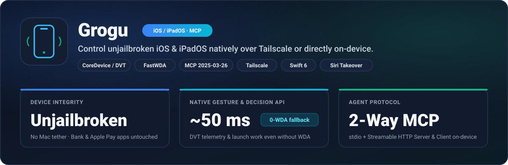
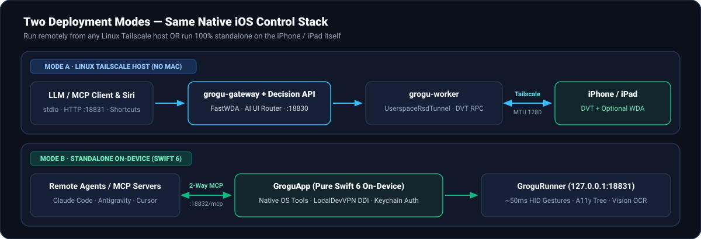

<p align="center">
  
</p>

<p align="center">
  <a href="https://github.com/Overbaker/grogu/releases/latest"></a>
  <a href="LICENSE"></a>
  
  
  
</p>

<p align="center">
  <a href="#quick-start"><strong>Quick Start</strong></a> ·
  <a href="#on-device-swift-6-app-ios"><strong>On-Device iOS App</strong></a> ·
  <a href="https://github.com/Overbaker/grogu/releases/latest"><strong>Unsigned IPAs</strong></a> ·
  <a href="CONTRIBUTING.md"><strong>Contribute</strong></a> ·
  <a href="https://github.com/Overbaker/grogu/discussions"><strong>Discussions</strong></a>
</p>

---

**Grogu (`grogu-ios`)** controls **unjailbroken iPhone and iPad devices** natively over **Tailscale** (from any Linux host — **no Mac tether**) or **100% standalone on-device** (pure Swift 6), keeping banking, broker, and Apple Pay apps completely untouched while giving AI agents and scripts full UI trees, deep CoreDevice/DVT telemetry, Siri takeover, and bidirectional **MCP (`2025-03-26`)** integration.

## Architecture

<p align="center">
  
</p>

## Core Capabilities

| Pillar | What It Gives You | Works Without WDA? |
|---|---|---|
| **Tailscale RSD Tunnel** (`grogu-worker`) | Pure-Python `UserspaceRsdTunnel` (`MTU=1280`), auto-mounts Personalized DDI, multiplexes WDA + DVT RPC + XCUITest over WAN | Yes |
| **Dual-Speed UI & Decision API** | Zero-WDA fallback (`AccessibilityAudit` + `ProcessControl` + DVT screenshots), `FastWDA`, millisecond `ios_decision_run`, dual-tier AI router (`ios_ai_act`), optional sub-30ms `wda_patch/` | Inspection & launch: **Yes** · Touch gestures: WDA |
| **Deep System Telemetry** (`ios_lowlevel_telemetry`) | `summary`, `Sysmontap` per-PID CPU/MB, `ioregistry` battery/watts/temp, app URL `schemes`, live `oslog`, wireless `NetworkStatistics` | **Yes** |
| **Siri & Vocal Shortcuts** (`ios_siri/`) | `POST /api/siri/command` replies synchronously for queries (`"speak"`) and dispatches background async LLM actions without timeouts | **Yes** |

## Quick Start

### 1. Linux Tailscale Host + MCP Server

```bash
git clone https://github.com/Overbaker/grogu.git && cd grogu
python3 -m venv .venv && .venv/bin/pip install -e ".[worker]"
cp .env.example .env
GROGU_DEVICE_IP=100.64.0.10 GROGU_BIND_HOST=100.64.0.1 grogu-gateway
```

<details>
<summary><strong>Step-by-step: One-time Mac USB pairing, optional WDA sideload & MCP config</strong></summary>

#### One-Time USB Pairing (on Mac, same Tailscale network)
```bash
curl -fsSL http://<YOUR_GATEWAY_TAILSCALE_IP>:18830/bootstrap/mac.sh | bash
```
Pairs `lockdown` + `RemotePairing`, enables Wi-Fi connections, and uploads `<udid>.plist` + `remote_<udid>.plist` to `~/.pymobiledevice3/` on your Linux host.

#### Optional: Sideload WDA for Touch Injection
> DVT telemetry, wireless `NetworkStatistics`, `AccessibilityAudit` UI trees, app launches, screenshots, and Siri voice queries already work **without WDA**.

1. Enable **Settings → Privacy & Security → Developer Mode** on your iPhone/iPad.
2. Repackage WDA so sideloaders (`apple-codesign` / AltStore / SideStore / Impactor / `plumesign`) sign it properly:
   ```bash
   grogu-prepare-wda-ipa --download -o ~/.config/grogu/WebDriverAgentRunner-sideload.ipa
   ```
   *(Also served at `GET /bootstrap/wda-sideload.ipa`.)*
3. Sign, install, trust your developer cert, unplug USB, and start the daemon:
   ```bash
   GROGU_DEVICE_IP=100.64.0.10 grogu-worker daemon
   ```

#### Register `grogu-mcp` in Your MCP Client
```json
{
  "mcpServers": {
    "grogu-ios": {
      "command": "/path/to/grogu/.venv/bin/grogu-mcp",
      "args": ["--transport", "stdio"],
      "env": {
        "GROGU_DEVICE_IP": "100.64.0.10",
        "GROGU_BIND_HOST": "100.64.0.1"
      }
    }
  }
}
```

</details>

## On-Device Swift 6 App (`ios/`)

Run the entire agent, native OS tools, GUI engine, and **bidirectional Streamable HTTP MCP (`:18832/mcp`)** directly on your iPhone/iPad with zero VM:

- **Native-First OS Agent**: `device_info`, `clipboard_*`, `calendar_*`, `reminders_*`, `contacts_search`, `location_get`, `photos_list_recent`, `notification_post`, `url_open`, `shortcut_run`, bounded `http_fetch`.
- **Ultra-Fast `GroguRunner` (`127.0.0.1:18831`)**: Synthesized HID gestures (`~50ms`), bounded Accessibility snapshots, `Vision` OCR fallback (~1–2 MB IPA, adapted from [OpenMinis/iCTRL](https://github.com/OpenMinis/iCTRL)).
- **Mac-Free On-Device DDI Mount**: [jkcoxson/idevice](https://github.com/jkcoxson/idevice) + `LocalDevVPN` (`10.7.0.1:49152`), including Cryptex DDI (`iOS 26.4+`).
- **Bidirectional MCP**: Expose on-device tools to Claude Code / Antigravity / Cursor with Keychain Bearer auth, *and* connect Grogu to remote Streamable HTTP MCP servers.

Download prebuilt unsigned IPAs (`GroguApp.ipa`, `GroguRunner.ipa`, `GroguRunner-sideload.ipa`) from [**Latest Release**](https://github.com/Overbaker/grogu/releases/latest) (sign with SideStore, AltStore, Impactor, or Xcode) — or build from `ios/` with Xcode 16 + XcodeGen (`cd ios && make ipa UNSIGNED=1`).

<details>
<summary><strong>FAQ</strong></summary>

- **Does Grogu require jailbreaking my iPhone or iPad?** No — it runs strictly on unjailbroken iOS/iPadOS devices using Apple's standard Developer Mode + CoreDevice/DVT protocols, keeping banking and Apple Pay apps untouched.
- **Do I need a Mac running 24/7?** No. A Mac is only needed once for initial USB pairing (or zero Mac at all if using the standalone on-device Swift 6 app with `LocalDevVPN`).
- **Can I use Grogu with Claude Code, Cursor, or Antigravity?** Yes — connect via `grogu-mcp` (stdio/HTTP on Linux) or the on-device Streamable HTTP MCP server (`:18832/mcp`).

</details>

---

## License

Root Python gateway & tooling: **MIT** © 2026 [Overbaker](https://github.com/Overbaker).  
Native `ios/` targets (`GroguApp` & `GroguRunner`): **Apache-2.0** (see [ios/NOTICE](ios/NOTICE)).
