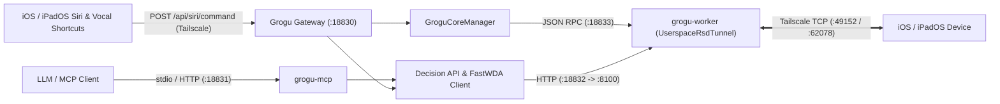

# Grogu (`grogu-ios`)

> *Control unjailbroken iOS / iPadOS devices natively over Tailscale — direct CoreDevice/DVT telemetry, millisecond Decision API, FastWDA UI trees, Siri voice takeover, and MCP integration for LLMs.*

[](LICENSE)
[](pyproject.toml)

Grogu lets a Linux server (or any Tailscale peer) control an **unjailbroken** iPhone or iPad **without keeping a Mac tethered** — keeping banking, broker, and Apple Pay apps 100% untampered while giving LLMs and deterministic scripts full native UI hierarchy access and deep system telemetry.

---

## Architecture



### Four Core Pillars
1. **No-Mac, No-Root Tailscale RSD Tunnel (`grogu-worker`)**
   - Uses `pymobiledevice3`'s pure-Python `UserspaceRsdTunnel` directly over Tailscale TCP (`RemotePairing` port `49152` or `CoreDeviceTunnelProxy` over `62078`) — bypassing mDNS/Bonjour multicast limitations.
   - Clamps `REQUESTED_MTU = 1280` for reliable WAN/Tailscale framing and auto-mounts the Personalized Developer Disk Image (`auto_mount`) when `com.apple.dt.testmanagerd.remote` is absent after a reboot (on high-RTT Tailscale links, `sudo pymobiledevice3 remote tunneld` + `mounter auto-mount` can pre-mount DDI in ~10s).
   - Multiplexes WDA port forwarding (`127.0.0.1:18832 -> device:8100`), a shared DVT telemetry RPC socket (`127.0.0.1:18833`), and an `XCUITestService` supervisor on a single RSD tunnel.
2. **Dual-Speed UI Control (`FastWDAClient` + `DecisionEngine`) — Works Even Without WDA**
   - **Zero-WDA Native Fallback**: Before or without WebDriverAgent running, `ios_ui_dump` (`GET /api/ui/dump`) automatically falls back to DVT `AccessibilityAudit`, `launch` / `open_url` fall back to `DvtProvider` `ProcessControl` (`dvt_launch`), and screenshots use DVT `Screenshot` — zero sideloading required for inspection, deep-link app launching, and voice reading.
   - **Full Gesture Mode (`FastWDA`)**: Compacts the XCUITest accessibility hierarchy (`type`, `label`, `name`, `value`, `rect`, `center`) with `waitForIdleTimeout=0` and `waitForQuiescence=false`.
   - **Decision API (`ios_decision_run` / `POST /api/decision/execute`)**: Executes deterministic steps (`launch`, `open_url`, `tap`, `tap_selector`, `wait_selector`, `swipe`, `type`, `button`, `sleep`, `reflex`, `ai_tap`) with per-step millisecond telemetry.
   - **Dual-Engine AI UI Router (`ios_ai_act` / `POST /api/ai/act`)**:
     - *Tier-1 Zero-Output-Token Selector*: Uses OpenRouter `google/gemini-decision-1` (`OPENROUTER_API_KEY`) to score `noul` completion + candidate element choice in a single prefill pass.
     - *Tier-2 Fast Non-Thinking LLM Planner*: Uses any OpenAI-compatible endpoint (`GROGU_LLM_BASE_URL`, `GROGU_LLM_API_KEY`, `GROGU_LLM_MODEL`) with configurable `GROGU_LLM_DISABLE_THINKING=true` (`chat_template_kwargs: {"enable_thinking": false}`) for sub-second JSON step selection and complex Siri `async_llm` tasks.
   - **Custom On-Device Patch (`wda_patch/`)**: Optional Objective-C `FBGroguCommands` extension adding `/grogu/fast_tree` and `/grogu/reflex` for sub-30ms on-device polling and tap synthesis.
3. **Deep System Telemetry (`ios_lowlevel_telemetry` / `GET /api/telemetry/{kind}`)**
   - `summary`: Device identity, Developer Mode status, battery, running apps.
   - `processes`: Live `Sysmontap` CPU & memory footprint (`MB`) per PID.
   - `ioregistry`: Battery capacity, voltage, amperage, adapter watts, temperature, Wi-Fi state.
   - `schemes`: Installed apps and every registered `CFBundleURLTypes` URL Scheme for instant deep-link jumps.
   - `oslog`: Live unified system logs (`ActivityTraceTap`).
   - `network`: Uses `PcapdService` over USB or automatically switches to DVT `DeviceInfo.network_information()` + `NetworkStatistics` over wireless Tailscale RSD.
   - `accessibility`, `dvt_launch`, `dvt_kill`, `screenshot`.
4. **Non-Blocking Siri & Vocal Shortcuts Takeover (`ios_siri/`)**
   - `POST /api/siri/command` answers status & screen-read queries synchronously (`"speak"`), while action commands return an immediate TTS acknowledgment and wait **450ms** before injecting UI actions so the Siri overlay dismisses first.
   - Supports both a 60-second **Apple Shortcuts + iOS/iPadOS 18+ Vocal Shortcuts** setup and native Swift `AppIntents` (`GroguSiriIntents.swift`).

---

## Quick Start

### 1. Install on your Linux Tailscale Host
```bash
git clone https://github.com/Overbaker/grogu.git
cd grogu
python3 -m venv .venv
.venv/bin/pip install -e ".[worker]"
cp .env.example .env
# Edit .env with your device's Tailscale IP (GROGU_DEVICE_IP) and host Tailscale IP (GROGU_BIND_HOST)
```

Start the gateway (on your Tailscale interface):
```bash
GROGU_DEVICE_IP=100.64.0.10 GROGU_BIND_HOST=100.64.0.1 grogu-gateway
```

### 2. One-Time USB Pairing Bootstrap (on Mac)
Plug your iPhone/iPad into a Mac on the same Tailscale network, unlock it, and run:
```bash
curl -fsSL http://<YOUR_GATEWAY_TAILSCALE_IP>:18830/bootstrap/mac.sh | bash
```
This installs your host's SSH public key, pairs `lockdown` + `RemotePairing` over USB, enables Wi-Fi connections, and uploads `<udid>.plist` + `remote_<udid>.plist` to `~/.pymobiledevice3/` on your Linux host.

### 3. Enable Developer Mode & Prepare Sideloader-Compatible WDA (Optional for Touch Injection)
> Note: **DVT telemetry, wireless `NetworkStatistics`, `AccessibilityAudit` UI trees, app launches, screenshots, and Siri voice queries already work without WDA.** Install WebDriverAgent when you also want synthesized touch taps/swipes/typing.

1. On the iPhone/iPad: **Settings → Privacy & Security → Developer Mode** → ON (reboot & confirm).
2. Sideloaders using `apple-codesign` (Impactor, AltStore, SideStore, `plumesign`) skip signing `PlugIns/*.xctest` bundles (causing `mapped file has no cdhash`). Repackage the upstream release into `Frameworks/WebDriverAgentRunner.framework` first:
```bash
grogu-prepare-wda-ipa --download -o ~/.config/grogu/WebDriverAgentRunner-sideload.ipa
```
   The gateway also serves this file over Tailscale at `GET /bootstrap/wda-sideload.ipa`.
3. Sign & install `~/.config/grogu/WebDriverAgentRunner-sideload.ipa` via Impactor, `plumesign --apple-id --register-and-install`, or Xcode, and trust your developer certificate under **Settings → General → VPN & Device Management**.
4. Unplug the USB cable and start the persistent tunnel & WDA supervisor (supports both `PlugIns/*.xctest` and `Frameworks/*.framework`):
```bash
GROGU_DEVICE_IP=100.64.0.10 grogu-worker daemon
```

### 4. Register as an MCP Server (Linux Gateway)
Add to your MCP client configuration (e.g. `mcp_config.json`):
```json
{
  "mcpServers": {
    "grogu-ios": {
      "command": "/path/to/grogu/.venv/bin/grogu-mcp",
      "args": ["--transport", "stdio"],
      "env": {
        "GROGU_DEVICE_IP": "100.64.0.10",
        "GROGU_BIND_HOST": "100.64.0.1"
      }
    }
  }
}
```

---

## Native On-Device iOS / iPadOS App (`ios/`)

Grogu also ships a standalone, zero-VM pure Swift 6 + Objective-C XCUITest native app (`ios/GroguApp` + `ios/GroguRunner`) so the entire agent, local OS tools, GUI engine, and **bidirectional Streamable HTTP MCP Server & Client** run directly on-device:

- **Native-First OS Agent**: Executes `device_info`, `clipboard_*`, `calendar_*`, `reminders_*`, `contacts_search`, `location_get`, `photos_list_recent`, `notification_post`, `url_open`, `shortcut_run`, and bounded `http_fetch` before falling back to GUI automation.
- **Ultra-Fast `GroguRunner` (`127.0.0.1:18831`)**: Adapts [OpenMinis/iCTRL](https://github.com/OpenMinis/iCTRL) (Apache-2.0) quiescence/screen-recording suppression, synthesized HID gestures (`~50ms`), bounded viewport Accessibility snapshots, and `Vision` OCR fallback (~1–2 MB Runner IPA).
- **Mac-Free On-Device DDI Mount**: Uses [jkcoxson/idevice](https://github.com/jkcoxson/idevice) (MIT) + `LocalDevVPN` (`10.7.0.1:49152`) to mount Personalized & Cryptex (`iOS 26.4+`) Developer Disk Images directly from the iPhone/iPad.
- **Bidirectional MCP (`2025-03-26` Streamable HTTP)**:
  - **MCP Server (`:18832/mcp`)**: Expose on-device native OS tools, GUI automation, `grogu://*` resources, and `grogu_agent_run` to Antigravity / Claude Code / Eta / Cursor over loopback or Tailscale/LAN with Keychain-stored Bearer token auth.
  - **MCP Client**: Connect Grogu on-device to any remote Streamable HTTP MCP server (`tools/list`, cursor pagination, SSE + JSON responses, `tools/call`).
- **Jetsam-Safe Memory & Thermal Discipline**: Live `task_vm_info` + `os_proc_available_memory()` monitoring, bounded ring buffers, streaming DDI downloads, `autoreleasepool` frame capture, and on-demand silent audio keep-alive only while an active task runs.

Prebuilt unsigned ad-hoc IPAs are checked directly into [`ios/release/`](ios/release/) (`GroguApp.ipa`, `GroguRunner.ipa`, `GroguRunner-sideload.ipa`) and published on [GitHub Releases](https://github.com/Overbaker/grogu/releases/latest) (sign & install with SideStore, AltStore, Impactor, or Xcode).

Or build from source on macOS with Xcode 16 + XcodeGen (`ios/`):
```bash
cd ios
make ipa UNSIGNED=1
# Outputs release/GroguApp.ipa, release/GroguRunner.ipa, release/GroguRunner-sideload.ipa
```

See [ios/NOTICE](ios/NOTICE) for third-party attributions (`iCTRL` Apache-2.0, `idevice` MIT).

---

## License

Root Python gateway & tooling: MIT © 2026 [Overbaker](https://github.com/Overbaker).  
Native `ios/` targets (`GroguApp` & `GroguRunner`): Apache License 2.0 (see [ios/NOTICE](ios/NOTICE)).
